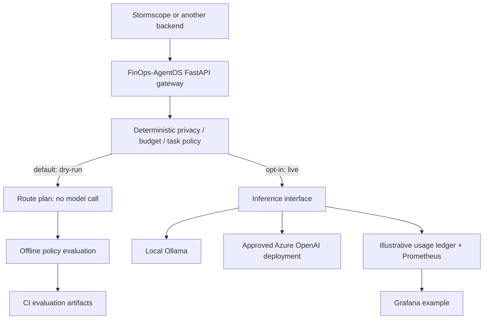

# FinOps-AgentOS

**An open-source, policy-driven AI inference control-plane laboratory.**

> **Mission:** Help organizations choose approved AI execution paths and demonstrate their **security, reliability, quality and true unit economics**. This is an experimental portfolio project, not a production-ready AI platform or a verified cost-saving product.

[](https://github.com/MrDataScientist/FinOps-AgentOs/actions/workflows/ci.yml) · [Architecture](docs/architecture.md) · [Stormscope demo](docs/stormscope-integration.md) · [Evaluation evidence](docs/evaluation-results.md) · [Case study](docs/portfolio-case-study.md)

## The enterprise problem

AI teams need to know **which model is permitted**, whether an answer is reliable, and how much *each accepted business outcome* costs. A nominally cheap model can be expensive when it fails or needs repeated work. Local models consume infrastructure even without a per-token API bill.

FinOps-AgentOS is a reusable component—not a replacement for the applications using it. **Stormscope** is the first reference integration: its deterministic weather-risk service owns the numerical decision; this project can route an *optional explanation request* to an eligible model.



## What is implemented today?

| Capability | State | Evidence |
| --- | --- | --- |
| FastAPI gateway and typed routing | **Implemented** | `POST /api/v1/route/plan`, unit/API tests |
| Fail-closed routing based on classification / task / illustrative budget | **Implemented** | [offline evaluation](docs/evaluation-results.md), CI-published reports |
| Opt-in Ollama and Azure OpenAI adapters | **Implemented, not live-benchmarked** | `POST /api/v1/infer` off by default |
| Stormscope risk-to-explanation contract | **Synthetic reference demo only** | [reproducible walkthrough](docs/stormscope-integration.md) |
| Token/latency counters and illustrative cost estimates | **Prototype** | In-memory ledger; Prometheus/Grafana example |
| Production safety validation, tenant IAM, real cost enforcement, live model evaluation | **Not implemented** | Explicit follow-up work |
| Self-healing, audited infrastructure mutations, live Stormscope production integration | **Not implemented** | Future architecture and approval gates |

**Do not interpret routing tests as evidence of LLM accuracy, validated cost savings, or production security.**

## Run it locally — no cloud account, key or model required

Python 3.11+:

```bash
python -m venv .venv
source .venv/bin/activate
pip install -e '.[dev]'
python -m pytest -q
ruff check .
uvicorn app.main:app --host 127.0.0.1 --port 8080
```

API docs: http://127.0.0.1:8080/docs

```bash
curl -X POST http://127.0.0.1:8080/api/v1/route/plan \
  -H 'Content-Type: application/json' \
  -d '{"task_kind":"explanation","classification":"public","prompt":"Explain a synthetic weather scenario."}'
```

### Stormscope reference demonstration

```bash
python -m integrations.stormscope.demo
```

This reads **invented** Stormscope-shaped weather-risk data and calls the real FinOps-AgentOS FastAPI route-planning API *in process*. It reports the selected route, keeps the application's risk score unchanged, and makes **zero external API/model calls**. See [integration instructions](docs/stormscope-integration.md).

### Reproduce the first evaluation

```bash
python -m app.evaluation.offline --output artifacts/offline-evaluation
```

The offline suite exercises **25 synthetic labelled routing cases** through the live application code path. It writes `policy-report.json` and `policy-cases.csv`. Every PR's GitHub Actions workflow runs the suite and uploads the report as an artifact. These are **actual policy decisions and observed in-process request timings**, not model outputs or provider bills.

See [evaluation boundaries and how to reproduce](docs/evaluation-results.md).

### Docker / Podman

```bash
podman compose -f infrastructure/compose.yaml up --build
# Or: docker compose -f infrastructure/compose.yaml up --build
```

The API binds to host loopback `127.0.0.1:8080`. Optional Prometheus: `--profile observability`. Do not expose this prototype's unauthenticated dry-run endpoint on the Internet.

## Optional inference — explicit opt-in

Use Ollama with an installed local model, or an **approved** Azure OpenAI deployment. Set `ENABLE_LIVE_EXECUTION=true`, `CONTROL_PLANE_API_KEY` (minimum 24 characters), and the appropriate provider configuration from [`.env.example`](.env.example). Never commit real keys. The Compose sample keeps live execution disabled.

Even when enabled, the response is marked `quality_validated=false`. Model responses must undergo independent grounding, safety and application-domain validation before serving users. An Azure-hosted gateway cannot depend on your personal laptop's Ollama server in production.

## Cost claims, evaluation and privacy

- **All starter cost rates are hypothetical**; local inference is not free once hardware, electricity and operations are included.
- The ledger is ephemeral and counts estimates, not real charges. Dollar savings are **not** calculated.
- The offline suite evaluates **policy contract correctness**, not inference accuracy or production latency.
- Cost per accepted answer and comparative savings require real billing, stable workloads, independent quality labels, provider metadata and complete TCO.
- Examples contain **only synthetic data**. Keep user locations, sensitive inputs and provider credentials out of committed fixtures, logs and publicly uploaded benchmark reports.
- FinOps-AgentOS never computes or overrides Stormscope's authoritative weather-risk score.

## Roadmap

1. **Current:** repeatable policy evaluations, Stormscope synthetic adapter, explicit routing and observability.
2. **Next:** opt-in live Ollama/approved cloud model experiments, independent explanation quality labels, cost and latency per accepted result.
3. **Later:** approved model-routing improvements, reconciled token/compute costs, tenant-level controls and reliable fallbacks.
4. **Long term:** human-approved infrastructure change proposals, Terraform policy gates, rollback and audited recovery.

[Contributing](CONTRIBUTING.md) · [Gitmoji guidelines](AGENTS.md) · MIT license. Model licenses and cloud-service contracts are separate.
