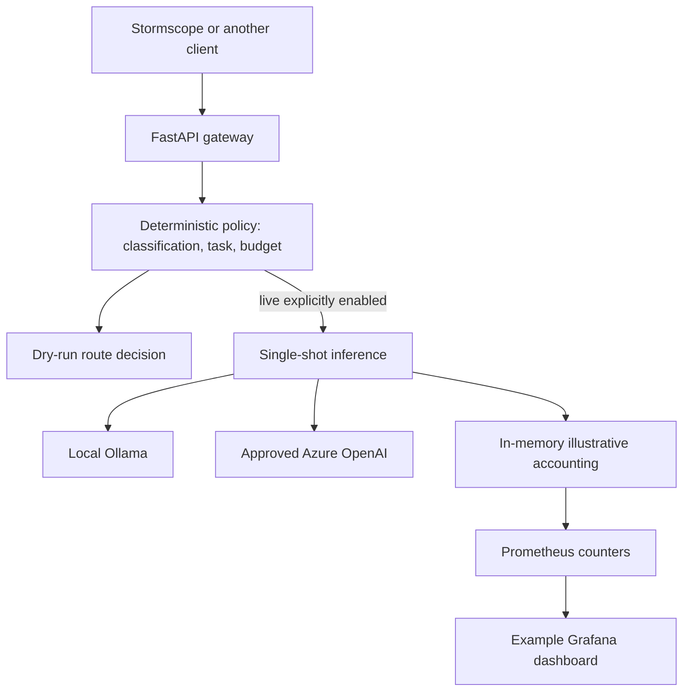

# Architecture and scope

**Status: reference MVP**, not a deployed enterprise-grade platform.

## Boundaries and risks

- Typed Pydantic requests use forbidden extra fields. The policy is deterministic, not LLM-generated.
- Internal/restricted prompts are local-only. Public simple explanations prefer local; complex public requests require an explicitly enabled Azure route. This is **starter policy, not compliance certification**.
- Budgets constrain **illustrative assumptions**, not real token spend. Production requires reserved quotas, metered prices and durable reconciliation.
- Live execution requires a configured API key and is disabled by default. Keyless dry-run mode is for loopback development only.
- Output is returned with `quality_validated=false`: callers own correctness and safety validation. Providers may independently retain logs.
- No provider fallback, automatic retries, official weather alerts, infrastructure writes, self-healing or agent autonomy is implemented.
- `/metrics` has aggregate labels only, but must be restricted by network policy if exposed outside a local lab.
- The Stormscope adapter builds an explanation-only request from precomputed risk facts. It is not yet connected to Stormscope's live backend and does not update its risk policy.
- No multi-tenant authorization or persistent ledger. Do not deploy this starter publicly without hardening.

The project separates **data-plane requests** from later **FinOps analysis and governed control-plane operations**. Future routing changes must be evaluated against measurable quality, privacy and availability requirements.
