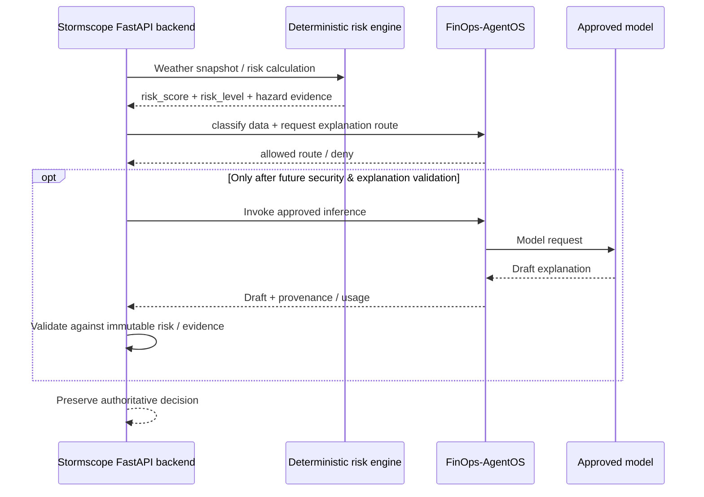

# Stormscope: first reference integration

**State:** Executable **synthetic** integration against the FinOps-AgentOS FastAPI plan endpoint; **not** deployed into Stormscope or connected to real weather providers. This public project does not embed credentials or private application code.

## The boundary

Stormscope owns its weather retrieval, provenance, risk score/band, hazards and official-warning separation. FinOps-AgentOS may decide an eligible inference route for *explanatory narrative* but must not change the score or assert official warnings.



For reference, Stormscope's backend exposes `POST /api/v2/agent/weather-risk` with a `question` and optional `include_guidance`; the response includes `risk_score`, `risk_level`, location, hazards and optional guidance. **This PR changes neither application**. The adapter accepts the relevant response subset and **requires an explicit data classification**. It rejects missing risk scores, locations or weather hazard evidence rather than inventing data.

## Reproduce the reference example

```bash
pip install -e '.[dev]'
python -m integrations.stormscope.demo
```

The fixture at `scenarios/stormscope-risk-synthetic.json` is invented, and is not a weather observation or an actual public warning. The demo invokes `POST /api/v1/route/plan` using `httpx.ASGITransport` against the real gateway implementation. It produces a dry-run route decision and confirms that the input risk score is unchanged. It performs **no live LLM call and no Stormscope-to-AgentOS network connection**.

## A future opt-in server-to-server integration

1. Keep the Angular UI calling **only** the Stormscope backend. Do not expose the AgentOS key in browser code.
2. Retrieve the weather-risk result in Stormscope and validate its canonical v2 risk/evidence contracts.
3. Explicitly classify the input, minimize personal/geospatial data, and authorize whether it may leave the Stormscope trust boundary.
4. Convert the risk response into `InferenceTask` via `from_weather_risk_response(payload, classification=...)`.
5. Have Stormscope call the **authenticated** FinOps-AgentOS endpoint over private/secured service networking. Initially use `/api/v1/route/plan`.
6. Once evaluated, optionally call `/api/v1/infer` and validate every generated narrative against the immutable score, evidence IDs, citations and limitations. **The current AgentOS output has `quality_validated=false`; do not show it as validated safety advice**.
7. Compare the direct Azure explanation baseline against the gateway's approved model alternative on the same recorded scenarios before switching traffic.
8. Record consent/privacy basis, IAM controls, cost ownership, recovery behavior and a rollback plan; begin behind a feature flag.

**No claim of production integration or model quality is made by the current demo.**
